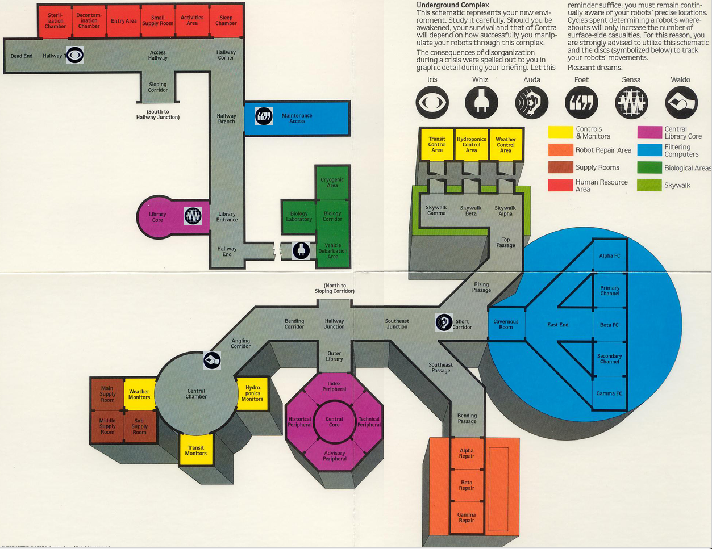

# Suspended(1983) map assistant
A simple app made in Python, Pillow and Tkinter that serves as a sidekick in you journey
through the Undergound Complex in the splendid game entitled Suspended.



# How to run
## You can either install all dependencies with:
```bash
pip install -r requirements
```
and
```bash
python .\Suspended_map.py
```

## or
Make an *.exe file:
```bash
pyinstaller --onefile --windowed --add-data "icons;icons" --add-data "map;map" Suspended_map.py
```

## Have fun and don't let people come into the complex!